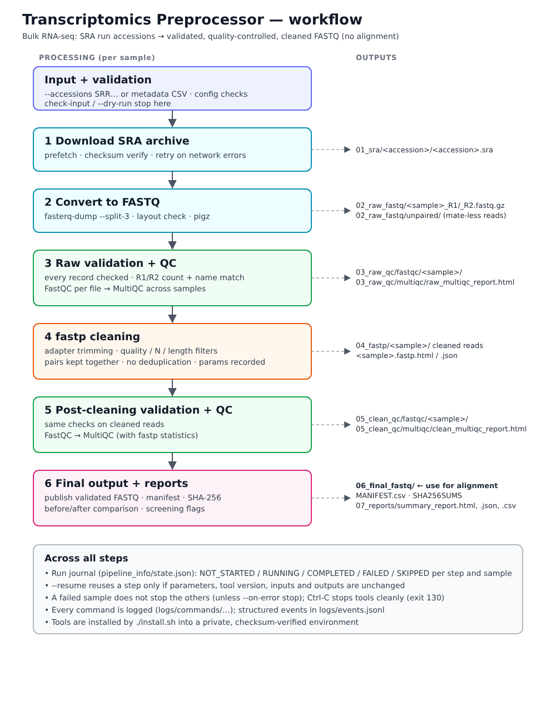

# Transcriptomics Preprocessor

**`transcriptomics-preprocess`** turns NCBI SRA run accessions into quality-controlled,
cleaned FASTQ files for bulk RNA-seq, with one command, on an ordinary Ubuntu machine.

```
SRA accessions / sample sheet
  → input validation → prefetch (download) → fasterq-dump (FASTQ) → FASTQ integrity check
  → FastQC + MultiQC (raw) → fastp (adapter/quality cleaning) → FASTQ integrity check
  → FastQC + MultiQC (cleaned) → before/after comparison → final FASTQ + reports
```



It is written for students, beginners and labs who want the standard
FastQC → fastp → MultiQC preprocessing done reproducibly, with every step explained
while it runs, without installing each tool by hand.

> **Scope.** This release performs *preprocessing and quality control only*. It does not
> align reads, count genes, run differential expression, analyse single-cell data or do
> pathway enrichment. The cleaned FASTQ files are the input for those steps (e.g. HISAT2
> or STAR, then featureCounts).

---

## Contents

1. [Features](#features)
2. [Supported systems and limitations](#supported-systems-and-limitations)
3. [Installation](#installation)
4. [Quick start](#quick-start)
5. [Input: accessions or a sample sheet](#input-accessions-or-a-sample-sheet)
6. [Output folder structure](#output-folder-structure)
7. [What each step does](#what-each-step-does)
8. [Reports and QC metrics](#reports-and-qc-metrics)
9. [Resuming, overwriting and dry runs](#resuming-overwriting-and-dry-runs)
10. [Cleaning parameters](#cleaning-parameters)
11. [Dependency management](#dependency-management)
12. [Troubleshooting](#troubleshooting)
13. [Testing](#testing)
14. [Scientific caveats](#scientific-caveats)
15. [Citation](#citation)
16. [License and contributing](#license-and-contributing)

## Features

- **One-step installation** (`./install.sh`) of SRA Toolkit, FastQC, fastp, MultiQC, pigz
  and Python into a private environment. No root, no `sudo`, no edits to `.bashrc`.
  The bootstrap binary is SHA-256 verified and the environment is built from a checksummed
  lock file.
- **Paired-end and single-end** runs, mixed freely in one project.
- **Input** as SRA run accessions (`SRR…`, `ERR…`, `DRR…`) or a CSV sample sheet with
  optional extra columns (e.g. `condition`) that are carried into the final manifest.
- **Strict validation** of input, configuration values and every FASTQ record (structure,
  gzip integrity, R1/R2 pairing), before and after cleaning.
- **Separate raw and post-cleaning QC** (FastQC per file, MultiQC per stage).
- **Before-versus-after comparison** built only from measured values, each with its source
  and definition; reads and read pairs are kept distinct.
- **Resumable**: a run journal records every step for every sample. A step is reused only
  if its parameters, tool version, inputs and outputs are unchanged.
- **Failure isolation**: one failing sample does not stop the others (configurable).
- **Explains itself**: each step prints its purpose, inputs, tool version, parameters,
  outputs and a short interpretation; `transcriptomics-preprocess explain` prints the guide.
- **Reports**: self-contained HTML summary, JSON summary, CSV tables, final manifest with
  SHA-256 checksums, structured logs and per-command logs.
- **Dry-run mode** that shows the validated plan and exact commands without touching data.

## Supported systems and limitations

| Item | Status |
|---|---|
| Ubuntu 24.04, x86-64 | **Tested** (installer, full test suite) |
| Other x86-64 Linux distributions | Expected to work (the environment is self-contained); untested |
| Linux aarch64 (ARM) | Installer supports it by solving `environment.yml`; untested |
| macOS, Windows | Not supported (Windows users can try WSL2 with Ubuntu; untested) |
| Input | SRA *run* accessions only. GEO (`GSE…`, `GSM…`), BioProject (`PRJNA…`), study/experiment accessions and URLs are rejected with guidance. |
| Protected data (dbGaP) | Not supported |

Real downloads from NCBI could not be exercised in the development environment (its
network blocks NCBI). The download/conversion code paths were tested with faithful test
doubles and against the real `prefetch` error output for an unreachable NCBI; see
[docs/validation_report.md](docs/validation_report.md).

## Installation

Requirements: Ubuntu (or another Linux) with `bash`, `curl` or `wget`, `tar`, `bzip2`
(present on standard Ubuntu installations), internet access to `conda.anaconda.org`, and
about 4 GB of free space for the software. Sequencing data need much more space; see
[Disk space](#disk-space).

```bash
git clone https://github.com/Kalsotra-ritvik/CleanSeqFlow.git
cd CleanSeqFlow
./install.sh
```

The installer prints numbered steps, verifies every tool, runs a small functional test,
and finishes with a summary. Then:

```bash
transcriptomics-preprocess --help
transcriptomics-preprocess doctor
```

If the command is not found, `~/.local/bin` is not yet on your `PATH`. Ubuntu adds it
automatically at your next login; for the current terminal run
`export PATH="$HOME/.local/bin:$PATH"`, or call the launcher by its full path (printed by
the installer). The installer never edits your shell start-up files.

| Task | Command |
|---|---|
| Update | `git pull && ./install.sh` |
| Repair a broken environment | `./install.sh --repair` |
| Check the installation | `transcriptomics-preprocess doctor --smoke-test` |
| Uninstall (results are kept) | `./uninstall.sh` |
| Remove old environments after updates | `./uninstall.sh --prune-old-envs` |
| Install elsewhere | `./install.sh --prefix /path/to/dir --bin-dir /path/to/bin` |

Details, including what is downloaded from where and how the checksum verification works:
[docs/installation.md](docs/installation.md).

## Quick start

```bash
# Check a sample sheet without running anything
transcriptomics-preprocess check-input --metadata examples/metadata.csv

# See exactly what would happen (no download, nothing created)
transcriptomics-preprocess run --metadata examples/metadata.csv --outdir RNAseq_results --dry-run

# Run with 8 threads
transcriptomics-preprocess run --metadata examples/metadata.csv --outdir RNAseq_results --threads 8

# Or give accessions directly
transcriptomics-preprocess run --accessions SRR26053372 SRR26053373 --layout paired \
    --outdir RNAseq_results --threads 8

# Continue after an interruption or after fixing a failed sample
transcriptomics-preprocess run --metadata examples/metadata.csv --outdir RNAseq_results --resume
```

Exit codes: `0` success · `2` invalid input or usage · `3` missing dependency ·
`4` partial failure (some samples or a report step failed) · `5` failure · `130` interrupted.

## Input: accessions or a sample sheet

**Accessions** (`--accessions SRR… --layout paired|single`): each accession also becomes the
sample name.

**Sample sheet** (`--metadata file.csv`): comma-, tab- or semicolon-separated, UTF-8.

```csv
sample,accession,layout,condition
siOGT_rep1,SRR26053372,paired,siOGT
siOGT_rep2,SRR26053373,paired,siOGT
siCtrl_rep1,SRR26053375,paired,siControl
```

| Column | Required | Meaning |
|---|---|---|
| `sample` | yes | Your name for the sample; used for output file names. Letters, digits, `.`, `_`, `-`; max. 100 characters; must be unique. |
| `accession` | yes | SRA **run** accession (`SRR`, `ERR` or `DRR` followed by digits). Must be unique. |
| `layout` | yes, unless `--layout` is given | `paired` or `single` (`PE`/`SE` also accepted). |
| anything else (e.g. `condition`, `batch`) | no | Kept as metadata in the manifest and report; not used for processing. |

All problems in a sheet are reported together. Lines starting with `#` are ignored.
To find the run accessions of a GEO series, use the NCBI SRA Run Selector
(<https://www.ncbi.nlm.nih.gov/Traces/study/>) and copy the `Run` and `LibraryLayout`
columns. Merging several runs into one sample is not supported in this release.

## Output folder structure

```
RNAseq_results/
├── 01_sra/<accession>/<accession>.sra        downloaded archives (kept unless --remove-sra)
├── 02_raw_fastq/<sample>_R1/_R2.fastq.gz     raw reads (single-end: <sample>.fastq.gz)
│   └── unpaired/<sample>_unpaired.fastq.gz   mate-less reads of paired runs, if any
├── 03_raw_qc/fastqc/<sample>/                FastQC on raw reads (HTML + zip)
├── 03_raw_qc/multiqc/raw_multiqc_report.html
├── 04_fastp/<sample>/                        fastp output + <sample>.fastp.html/.json
├── 05_clean_qc/fastqc/<sample>/              FastQC on cleaned reads
├── 05_clean_qc/multiqc/clean_multiqc_report.html   (includes fastp statistics)
├── 06_final_fastq/                           ← USE THESE for alignment
│   ├── <sample>_R1.fastq.gz, <sample>_R2.fastq.gz   (or <sample>.fastq.gz)
│   ├── MANIFEST.csv                          sample, file, reads, bytes, SHA-256
│   └── SHA256SUMS                            verify with: cd 06_final_fastq && sha256sum -c SHA256SUMS
├── 07_reports/
│   ├── summary_report.html                   start here
│   ├── summary.json                          everything, machine-readable
│   ├── qc_comparison.csv                     before/after metrics
│   ├── processing_status.csv                 status of every step per sample
│   ├── sample_manifest.csv                   samples, metadata, final files, counts
│   └── file_inventory.csv                    every file with its size
├── logs/pipeline.log, logs/events.jsonl, logs/commands/<sample>/<step>.log
└── pipeline_info/                            run journal, configuration used, software versions
```

Files in `06_final_fastq` are hard links to the fastp output (no extra disk space) when the
file system allows it, otherwise copies. Raw, intermediate and final data are kept separate,
and nothing is deleted automatically except the pipeline's own temporary files.

## What each step does

| Step | Tool | What happens | Checks before the step counts as complete |
|---|---|---|---|
| 1. Download | `prefetch` | Downloads the SRA archive; resumes partial downloads; verifies NCBI's checksum. Network failures are retried with increasing waits. | exit code 0, archive present and non-empty |
| 2. Convert | `fasterq-dump --split-3 --skip-technical`, `pigz` | Writes R1/R2 (or single) FASTQ in matching order; mate-less reads go to `unpaired/`; files are compressed. The declared layout is checked against the data. | expected files exist; layout matches |
| 3. Raw QC | built-in validator, FastQC, MultiQC | Every record checked (structure, characters, gzip, R1/R2 counts and names); FastQC per file; MultiQC across samples. | validator passes; reports exist and parse |
| 4. Cleaning | fastp | Adapter trimming, quality/N/length filtering with recorded parameters; pairs kept together. | fastp exit 0; outputs and JSON present and consistent |
| 5. Post QC | validator, FastQC, MultiQC | Same checks on cleaned reads; second MultiQC including fastp results. | as step 3 |
| 6. Final output | built-in | Publishes validated files, manifest, checksums, comparison and reports. | — |

`transcriptomics-preprocess explain` prints a longer explanation of every step and every
FastQC module; [docs/pipeline_explained.md](docs/pipeline_explained.md) has the full text.

## Reports and QC metrics

The HTML summary separates five kinds of information so they are not confused:

1. **Observed measurements**: exact read counts from the FASTQ validator.
2. **Tool-generated statistics**: fastp and FastQC values (bases, Q20/Q30 rates, GC, mean
   lengths, adapter content, duplication estimates).
3. **Software quality flags**: FastQC PASS/WARN/FAIL. These compare files with generic
   thresholds; several modules routinely flag good RNA-seq data.
4. **Automated screening**: configurable rules (retention below 70 %, fewer than 10 million
   cleaned reads/pairs, residual adapter above 5 %, Q30 below 70 %). They mark samples for
   review; they are heuristics chosen for this tool, not biological standards.
5. **Items needing expert review**: whether a sample is fit for a given analysis.

Missing values are shown as "not available", never estimated. Each comparison row names its
source (validator, fastp JSON, FastQC) and uses the same source before and after. Changes
between percentages are given in percentage points. Counts from fastp are cross-checked
against the validator, and any mismatch is reported as an inconsistency.

## Resuming, overwriting and dry runs

| Mode | Behaviour |
|---|---|
| default | The output directory must be new or empty. A directory with earlier results is refused, and so is a non-empty directory not created by this tool. |
| `--resume` | Reuses a completed step only if its parameters, tool version, input files and output files are unchanged; otherwise it and everything downstream are recomputed. Failed and interrupted steps are rerun. |
| `--overwrite` | Recomputes every step in an existing output directory of this tool. The previous journal is kept as `pipeline_info/state.before-overwrite.*.json`. `prefetch` still skips archives that are already complete. |
| `--dry-run` | Validates input, configuration, tools and the output location, and prints the planned actions and exact commands. Downloads nothing, creates nothing. With `--resume` it shows which steps would be reused. |

Ctrl-C (or SIGTERM) stops running tools, saves the journal, writes a partial report and
exits with code 130. Run the same command with `--resume` to continue. A second Ctrl-C
forces an immediate exit.

## Cleaning parameters

Defaults are **fastp's own documented defaults** (fastp 1.3.6), plus adapter auto-detection
for paired-end data. They are deliberately mild: no sliding-window trimming, no fixed
trimming, no deduplication.

| Setting | Default | Option | fastp flag |
|---|---|---|---|
| Phred quality for a "qualified" base | 15 | `--qualified-quality` | `-q` |
| Max % unqualified bases per read | 40 | `--unqualified-percent` | `-u` |
| Max N bases per read | 5 | `--n-base-limit` | `-n` |
| Minimum read length after trimming | 15 | `--min-length` | `-l` |
| Minimum mean read quality | off | `--average-quality` | `-e` |
| Adapter trimming | on (auto-detect) | `--no-adapter-trimming`, `--adapter-r1`, `--adapter-r2` | `-A`, `-a`, `--adapter_sequence_r2` |
| Sliding-window trimming | off | `--cut-front`, `--cut-tail`, `--cut-window-size`, `--cut-mean-quality` | `-5`, `-3`, `-W`, `-M` |
| polyG trimming | auto | `--trim-poly-g auto/on/off` | `-g` / `-G` |

All settings, including fixed trimming, polyX trimming, the low-complexity filter and the
screening thresholds, can be set in a YAML file passed with `--config`
(see [`config/default.yaml`](config/default.yaml) and [`examples/config.yaml`](examples/config.yaml)).
Unknown keys and out-of-range values are rejected.

fastp's default minimum length (15 bp) is permissive. If very short reads are not useful
for your aligner and read length, raise `--min-length`; the effect is visible in the
before/after comparison.

## Dependency management

There is **one** authoritative installation mechanism: `install.sh` creates a conda
environment with micromamba from
[`environment-lock-linux-64.txt`](environment-lock-linux-64.txt), an explicit list of 178
packages with MD5 checksums, solved from [`environment.yml`](environment.yml) (channels
`conda-forge` and `bioconda`, strict priority, no Anaconda `defaults` channel). pip installs
only this package into that environment, with `--no-deps --no-index`, so it never contacts
PyPI.

| Software | Version | Source |
|---|---|---|
| SRA Toolkit (`prefetch`, `fasterq-dump`) | 3.4.1 | bioconda |
| FastQC | 0.12.1 | bioconda |
| fastp | 1.3.6 | bioconda |
| MultiQC | 1.35 | bioconda |
| pigz | 2.8 | conda-forge |
| Python / PyYAML / pytest | 3.12 / 6.0 / 8.4 | conda-forge |
| micromamba (bootstrap) | 2.9.0 | conda-forge, SHA-256 pinned in `install.sh` |

Versions were chosen for maturity (released months before the lock was made), not novelty.
`pyproject.toml` declares only the minimum Python requirement (`PyYAML>=6.0`), which is
compatible with the pin.

## Troubleshooting

| Problem | What to do |
|---|---|
| `command not found` after installing | `export PATH="$HOME/.local/bin:$PATH"` or log in again. |
| `doctor` reports a missing tool | `./install.sh --repair` |
| "NCBI could not be reached" | Check the internet connection/proxy, then `--resume`. |
| "declared paired-end, but … single-end reads only" | Fix `layout` for that sample (check *LibraryLayout* in the SRA record). |
| Disk-space warning or "ran out of disk space" | Free space, or put temporary files elsewhere with `--tmpdir /bigdisk/tmp`, then `--resume`. |
| A run larger than 100 GB is refused | Set `download.max_size` in a config file. |
| "already contains results from a previous run" | Use `--resume`, `--overwrite` or another `--outdir`. |
| Residual adapter content flagged | Give the adapter explicitly, e.g. `--adapter-r1 AGATCGGAAGAGCACACGTCTGAACTCCAGTCA` (Illumina TruSeq). |

More in [docs/troubleshooting.md](docs/troubleshooting.md).

### Disk space

Plan for several times the SRA archive size per sample: the archive, the uncompressed FASTQ
written temporarily during conversion, the compressed raw FASTQ, and the cleaned FASTQ. The
pipeline warns when free space looks insufficient, using a configurable rule of thumb
(`conversion.space_factor`, default 7 × archive size); `fasterq-dump` also checks space
itself. Use `--remove-sra` to delete each archive after its sample has completed.

## Testing

```bash
# inside the installed environment (all tests, including those using the real tools):
eval "$(~/.local/share/transcriptomics-preprocessor/bin/micromamba shell activate -s bash \
        -p ~/.local/share/transcriptomics-preprocessor/env)"
python -m pytest tests -q

# without the bioinformatics tools (unit and CLI tests only; tool tests are skipped):
python -m pip install -e ".[dev]" && python -m pytest tests -q
```

Integration tests run the real FastQC, fastp, MultiQC and pigz on small synthetic datasets
and replace only `prefetch`/`fasterq-dump` with test doubles, so no NCBI access is needed.
The validation evidence, including what was **not** tested, is in
[docs/validation_report.md](docs/validation_report.md).

## Scientific caveats

- Automated QC describes technical properties of reads. It cannot establish that a sample is
  biologically valid (identity, contamination, rRNA content, strandedness, RNA integrity).
- FastQC flags are calibrated for generic DNA libraries. RNA-seq commonly fails *Per base
  sequence content* (random-hexamer priming bias) and shows high *duplication* (abundant
  transcripts). This pipeline therefore never removes duplicates.
- Adapter trimming and quality filtering do not prove data quality; the report shows the
  measured effect and flags cases where, for example, adapter content did not drop.
- fastp's adapter auto-detection can miss adapters, particularly in small single-end
  files; the comparison detects and reports this.
- SRA-derived read names lack the original instrument information, so fastp's automatic
  polyG trimming (for NextSeq/NovaSeq two-colour chemistry) usually does not trigger; use
  `--trim-poly-g on` for such data.
- If NCBI delivers SRA-lite files (simplified quality scores), quality-based results are less
  informative; the pipeline warns when this happens.

## Citation

If you use this tool, please cite the software it runs:

- **fastp**: Chen S, Zhou Y, Chen Y, Gu J. fastp: an ultra-fast all-in-one FASTQ
  preprocessor. *Bioinformatics* 2018;34(17):i884–i890. doi:10.1093/bioinformatics/bty560
- **MultiQC**: Ewels P, Magnusson M, Lundin S, Käller M. MultiQC: summarize analysis results
  for multiple tools and samples in a single report. *Bioinformatics* 2016;32(19):3047–3048.
  doi:10.1093/bioinformatics/btw354
- **FastQC**: Andrews S. FastQC: a quality control tool for high throughput sequence data.
  Babraham Bioinformatics. <https://www.bioinformatics.babraham.ac.uk/projects/fastqc/>
- **SRA Toolkit**: NCBI. <https://github.com/ncbi/sra-tools>

and this software itself via [`CITATION.cff`](CITATION.cff).

## License and contributing

**License: not yet selected.** The project owner has to choose one before public release
(see [`CHANGELOG.md`](CHANGELOG.md)). Until a `LICENSE` file is added, default copyright
applies and others may not reuse the code.

Contributions are welcome. Please read [CONTRIBUTING.md](CONTRIBUTING.md),
[CODE_OF_CONDUCT.md](CODE_OF_CONDUCT.md) and, for security issues,
[SECURITY.md](SECURITY.md).
